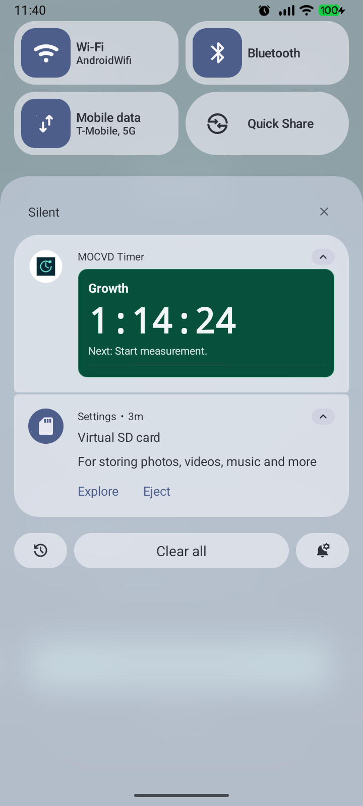
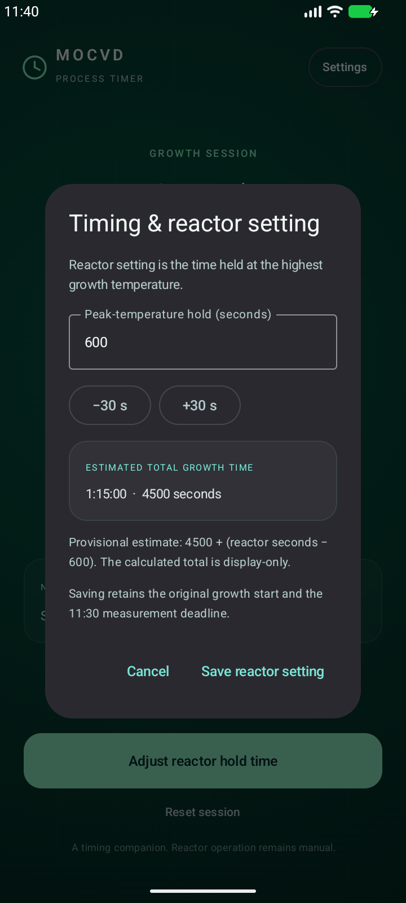
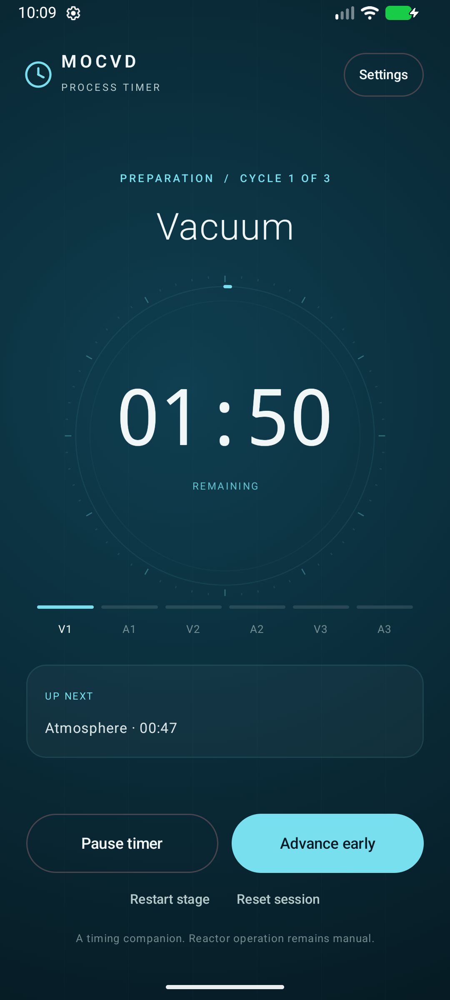
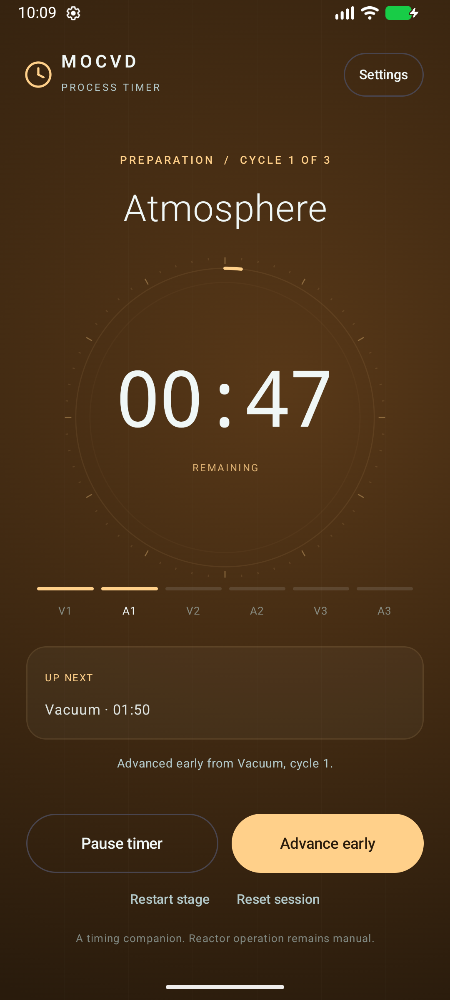
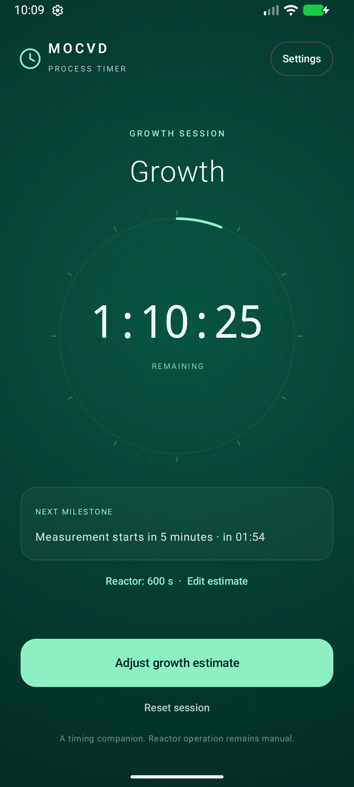

# MOCVD Timer

An offline Kotlin / Jetpack Compose Android app for a manually operated MOCVD laboratory workflow. App name: **MOCVD Timer**. Application ID: `lt.ignas.mocvd`.

**Version 1.2.0 (19 October 2026):** Growth Ready waits silently. The ongoing notification is a compact neutral row with a bold live countdown, without an expanded colored panel or activity bar. **Process complete** acknowledges finished growth in one click. **Prepare next growth** then skips vacuum/atmosphere cycles, retains the reactor hold setting, and waits for **Start Growth**. **Start full preparation** remains available.

**Version 1.1.1 (19 October 2026):** fixed stage-alarm audio initialization by loading the static PCM sound before requiring the playback-ready state. The fix remains included.

**Version 1.1.0:** edit only the peak-temperature hold time; the total is calculated and display-only. Measurement notification occurs only at **11:30**. Preparation stage completion plays **beep-beep … beep-beep** using alarm audio, without a separate push notification. The ongoing notification has a larger clock, stage-colored content, and an animated activity line when expanded.

## Open and run

Download the tested APK and portable source archive from the [latest GitHub release](https://github.com/igniux/mocvd-timer/releases/latest). Build outputs and local configuration are excluded from Git; the repository contains the Android Studio source, tests, and documentation.

1. In Android Studio Rabbit 1, **File → Open** this folder (the one containing `settings.gradle.kts`). If it was previously opened as an ordinary folder, close and reopen it. Accept Gradle sync.
2. Use Android Studio's bundled JDK in **Settings → Build, Execution, Deployment → Build Tools → Gradle**.
3. Install **Android SDK Platform 37** and **Build Tools 36.0.0** through SDK Manager if prompted. The project compiles with API 37 and **targets API 36 / Android 16**, including the OnePlus Nord 5. Minimum supported API: 26 / Android 8.
4. Choose an emulator in the device selector, select the `app` run configuration, and click Run.
5. In the app, open **Settings → Reminder permissions**, enable notifications and **Alarms & reminders**, then use **Test stage alarm** and **Test growth notification**. Stage beeps use the phone's **alarm volume**. Growth notifications use the selected notification channel.

The SDK path is local to each machine in ignored `local.properties`. Android Studio supplies it automatically. On this PC the SDK is under `%LOCALAPPDATA%\Android\Sdk`.

For a command-line build on Windows:

```powershell
powershell -ExecutionPolicy Bypass -File .\tools\build.ps1
```

This runs unit tests, Android lint, and the debug APK build. First build requires internet to download Gradle and Android libraries. **The installed app itself has no internet permission and works offline.**

Build without the helper, with `JAVA_HOME` set to Android Studio's JDK:

```powershell
.\gradlew.bat :app:testDebugUnitTest :app:lintDebug :app:assembleDebug
```

Debug APK: `app/build-v1.2.0/outputs/apk/debug/app-debug.apk`. This release uses a fresh output directory because Windows protected parts of the previous generated `app/build` tree from deletion. Source files stay in the same locations. The APK is a locally installable, debug-signed build for personal evaluation. The latest packaged APK is `deliverables/MOCVD-Timer-v1.2.0-debug.apk`. It updates earlier versions in place with the same package identity and signing key; an active v1.0 growth estimate is preserved until the hold time is saved.

`deliverables/MOCVD-Timer-v1.2.0-project.zip` contains the portable Android Studio source project, without local SDK paths, IDE settings or build caches. Recreate both packages after a validated build with `powershell -ExecutionPolicy Bypass -File .\tools\package.ps1`.

## Laboratory workflow

**Start process → Vacuum 1 → Atmosphere 1 → Vacuum 2 → Atmosphere 2 → Vacuum 3 → Atmosphere 3 → Growth Ready → Start Growth.**

- Vacuum timers are 110 seconds; atmosphere timers are 47 seconds.
- At zero the stage stays on screen, plays **two double beeps** on the alarm audio stream (and optionally vibrates), and waits indefinitely for **Start next stage**. It does not post a separate stage-completion push notification; the silent ongoing card updates to show waiting. Countdown expiry does not assert that a pressure was reached.
- **Advance early** requires confirmation and records the early transition. **Pause timer** pauses only a preparation timer. **Restart stage** and **Reset session** require confirmation.
- After the last atmosphere timer, the manual action opens **Growth Ready** without a push notification. Growth begins only after **Start Growth**.
- Default growth estimate: 4500 seconds (75 minutes).
- The measurement reminder is fixed at growth-start **+690 seconds (11:30)**. There is **no +390-second / five-minute pre-warning**. The notification says **Start measurement** and never pauses growth, changes its start, or opens a mandatory measurement screen.
- The completion warning is estimate-end −300 seconds; the final reminder says **Estimated growth time finished**. A shorter estimate retains the measurement deadline, even if that deadline falls after the estimated end; dismissing/resetting the session cancels all remaining reminders.
- At estimated completion, tap **Process complete** once to acknowledge the timer and clear its reminders. No confirmation popup appears. The estimate does not confirm physical reactor completion.
- Tap **Prepare next growth** to reuse the reactor hold setting and skip preparation cycles. Adjust the hold on Growth Ready, then tap **Start Growth** to start a fresh measurement/completion schedule. **Start full preparation** begins the six-stage preparation sequence instead. The next-growth option survives closing/reopening the app.

## Editing an estimate

**Configure timing**, **Edit**, or **Adjust reactor hold time** opens one numeric input: the **time held at the highest growth temperature**, in seconds. The estimated total is displayed, never directly editable. It recalculates from the user-confirmed provisional rule:

```text
estimated seconds = 4500 + (peak-temperature hold seconds − 600)
                  = 3900 + peak-temperature hold seconds
600-second hold → 4500-second estimate (75 minutes)
900-second hold → 4800-second estimate (80 minutes)
```

The UI explicitly labels this relationship as provisional. The hold can be zero; the resulting total must not exceed seven days. The earlier manual/conversion-mode controls are removed from the UI. Legacy records remain readable so an APK update does not silently reset or recalculate an active session.

Editing a running growth estimate preserves its original start and measurement deadline, cancels/replaces pending completion alarms, and retains handled reminder IDs. A previously delivered reminder is not repeated after extending a duration. An estimate changed into the past shows its overdue interval in the completion information.

## Timing, notifications, and recovery

- Pure Kotlin state machine in `domain/TimerEngine.kt`; UI rendering does not own timing.
- Elapsed-time calculations use Android's monotonic `elapsedRealtime`, including device sleep. Changing the wall clock during the same boot does not alter elapsed timing.
- One atomic JSON snapshot in app-private storage records the session, settings, timestamps, delivery/missed IDs, and planned reminders. State changes and receiver callbacks run on one serial executor. Storage failure stops scheduling and displays an error instead of silently discarding state.
- `AlarmManager.setAlarmClock` schedules the next critical milestone. The next alarm is deliberately system-visible and is rescheduled after each milestone. This avoids ordinary idle-alarm throttling for closely spaced milestones. No continuously running foreground service or internet connection is required.
- The app posts a silent ongoing status notification with a **bold 24 sp live countdown** beside the process name. Normal-speed countdowns use a system-managed Chronometer, which continues if the app process dies. The compact row uses system notification text colors, without a colored background, separate expanded panel, or activity/progress bar. Android controls the surrounding header and any system expansion affordance. Tapping the notification returns to the current stage.
- Four notification channels support growth reminder sound/vibration combinations. Stage beeps are generated directly as a short 1050 Hz alarm waveform: 140 ms beep, 100 ms gap, 140 ms beep, 500 ms gap, repeated double beep. The alarm receiver remains active through playback. Stage audio does not require notification permission, but timely background delivery requires exact alarms; alarm volume, Do Not Disturb and phone battery policy still apply. Missing permissions remain visible in the setup banner.
- Ordinary process termination and relaunch reconstruct the saved session; the alarm receiver can run without an open activity. Old alarm intents reconcile current state and never independently advance a stage.
- After a device reboot, active timing is reconstructed using saved wall-clock deadlines and **requires manual review** before alerts resume. An ongoing notification asks the user to open the app. Accept the estimate, edit it, restart a preparation stage, or reset. Offline timing cannot prove how the clock changed while powered off.
- Missed pre-reminders are coalesced into the corresponding main reminder when both are overdue; they are recorded as missed rather than replayed together. Stable per-session notification IDs and persisted handled IDs prevent routine duplicate alerts. Persistence and Android notification delivery are separate operations, so a crash at precisely that boundary can still lose an alert; this is not a real-time equipment controller.
- A phone that is powered off cannot alert. Android **Force stop** suspends app receivers until the app is opened again. After reopening, review overdue state and permissions. Uninstalling or clearing app storage deletes the session.

Continue all required reactor monitoring, equipment alarms, and laboratory procedures.

## Test mode and verification

With no session active, enable **Settings → Accelerated testing**. A persistent **SIMULATION · 30× SPEED** label appears. Stage and growth deadlines scale together: vacuum ≈3.67 real seconds; atmosphere ≈1.57 seconds; **no measurement alert at 13 seconds**; measurement start at **23 seconds**; default growth estimate end at **150 seconds**. The beep pattern stays at its normal real-time length. Displayed times remain laboratory-time units. Change this mode only between sessions.

Automated domain and persistence tests:

```powershell
.\gradlew.bat :app:testDebugUnitTest
```

UI / device smoke tests, with an emulator running:

```powershell
powershell -ExecutionPolicy Bypass -File .\tools\build.ps1 -Tasks :app:connectedDebugAndroidTest
```

Manual acceptance checklist and recovery commands: [docs/TESTING.md](docs/TESTING.md). Recorded execution results: [docs/VALIDATION.md](docs/VALIDATION.md).

`tools/check-background.ps1` performs an emulator-only simulation of process death, screen-off operation, idle mode, the absence of an early measurement warning, all three current growth reminders and estimated completion. It deliberately replaces this app's test session on the selected emulator. Its shortened manual-duration fixture exercises legacy state recovery; the normal app UI exposes only the hold-time-derived estimate. `tools/capture-screens.ps1` captures screens using actual UI actions and resets that emulator session afterward.

## Screens

Historical v1.1 notification and reactor settings (v1.2 uses the compact neutral notification):

| Expanded process notification | Reactor-only timing dialog |
| --- | --- |
|  |  |

| Vacuum | Atmosphere | Growth |
| --- | --- | --- |
|  |  |  |

## Source layout

| Location | Responsibility |
| --- | --- |
| `domain/TimerEngine.kt` | Process ordering, pause/restart, immutable starts, reminders, estimate edits, reboot reconstruction |
| `platform/SessionStore.kt` | Atomic state storage and versioned JSON codec |
| `platform/AlarmScheduler.kt` | Exact alarm access and next-event scheduling |
| `platform/Notifications.kt` | Reminder channels, event notices, ongoing countdown |
| `platform/Receivers.kt` | Alarm, boot, package update, wall-clock and permission recovery |
| `TimerController.kt` | Serialized state changes, persistence, alarm reconciliation |
| `ui/MocvdScreen.kt` | Stage colors, large timer, progress ring, settings and confirmations |

Build versions: AGP 9.4.0, Gradle 9.6.0, Compose compiler plugin 2.3.20, Compose BOM 2026.09.00. Project dependencies are pinned in the Gradle files.
